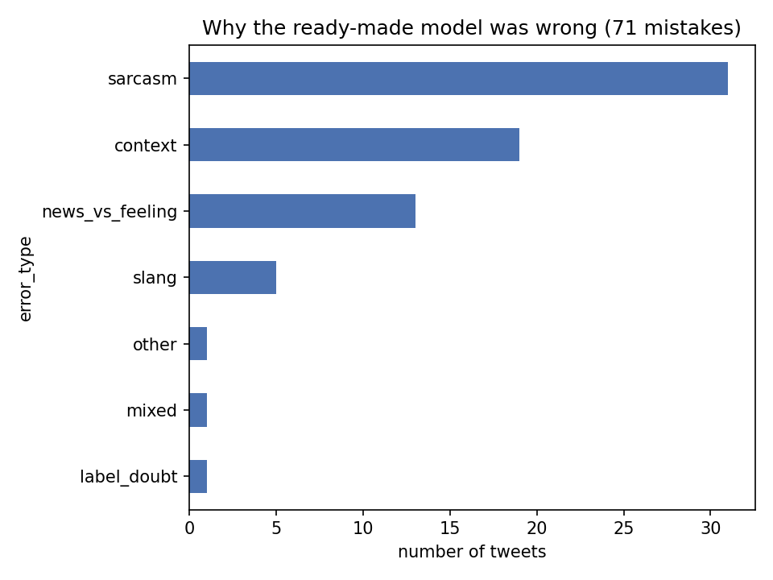
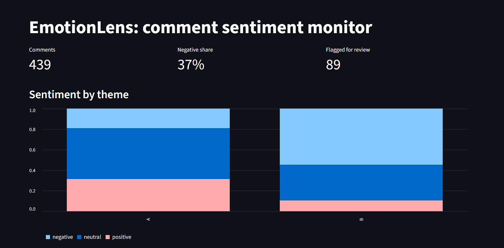
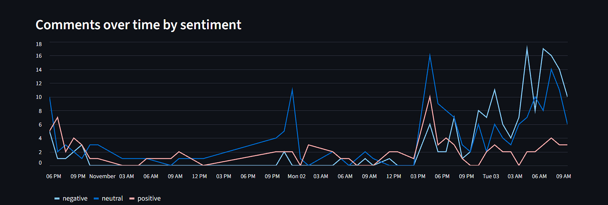

# EmotionLens v2

A sentiment-monitoring tool for public YouTube comments on defence and
government topics. It collects comments continuously, labels each one as
positive, neutral or negative, compares two themes, and flags comments for
human review.

**Status:** Phases 1 to 6 done. Phase 7 (labeling live comments, tests, model
card) in progress. Built as a learning project.

## Results

### 1. Benchmark: TweetEval sentiment (3 classes, test set)

| Model | Macro-F1 | Neutral recall | Note |
|---|---|---|---|
| Old Amazon-review model (v1 of this project) | 0.305 | 0.000 | Trained on reviews; cannot say "neutral" |
| VADER | 0.529 | 0.437 | Word-count rules; misses sarcasm |
| TF-IDF + Logistic Regression | 0.592 | 0.560 | Trained on tweets |
| Fine-tuned DistilRoBERTa (mine) | 0.702 | 0.630 | 2 epochs, about 2.5 min on a Colab T4 |
| Twitter-RoBERTa (ready-made) | 0.724 | 0.658 | Already fine-tuned on TweetEval by its authors |

Four hyperparameter settings gave validation scores between 0.69 and 0.717,
which is within noise, so I kept the simplest. Details are in `notebooks/`.

### 2. Hard set: 150 tweets, labeled by me

100 tweets where the ready-made model disagreed with the dataset, plus 50
irony tweets. First-draft labels were AI-assisted; I reviewed all of them and
changed about 50 to 60 (roughly a third).

- The ready-made model agrees with my labels on 53% of tweets (fine-tuned: 46%).
- Sarcastic tweets: 40% agreement (fine-tuned 26%), against 60% (57%) for the rest.
- Of 71 mistakes: sarcasm 31, needs outside context 19, news read as feeling 13,
  slang 5, other 3.
- The model is about as confident when it is wrong (about 0.70) as when it is
  right (about 0.68), so confidence alone cannot flag sarcasm.



Full write-up: [`results/phase4_findings.md`](results/phase4_findings.md)

### 3. Live YouTube comments

Six public videos, three per theme: **A** defence technology and **B** news and
policy. The first 439 comments were scored with the ready-made model:

| Theme | Negative | Neutral | Positive |
|---|---|---|---|
| A: defence technology | 19% | 50% | 31% |
| B: news and policy | 55% | 35% | 10% |




These are model outputs, not verified labels. News comments may look more
negative than they are, because models tend to read reporting as emotion.

Comment volume differed a lot by theme. In a four-hour test, the news videos
gained about 22 comments an hour and the defence videos gained one comment in
total, so Theme A results come mostly from the first collection.

## What is in the repo

```
src/collector.py         polls YouTube, stores new comments in SQLite (no duplicates)
src/export_comments.py   exports the database to CSV
src/check_videos.py      checks video IDs before adding them
app/dashboard.py         Streamlit dashboard
notebooks/               01 data, 02 baselines, 03 transformers, 04 error analysis, 05 scoring
results/                 findings and charts
```

## How to run

1. `pip install -r requirements.txt`
2. Create a free YouTube Data API key and put `YOUTUBE_API_KEY=...` in a `.env` file (never commit it).
3. Collect comments: `python src/collector.py --loop --every 10`
   (about 1,000 API calls a day; it stops itself at 8,000, under the free limit of 10,000).
4. Export with `python src/export_comments.py`, score with notebook 05
   (or locally with `requirements-ml.txt`), and save the result as `data/comments_scored.csv`.
5. Dashboard: `streamlit run app/dashboard.py`

## Data and privacy

- Only public data. Only comment text, time, like count and reply count are stored.
  No usernames.
- Comment text and tweet text are not in this repo. `data/` is git-ignored.
- Results are reported in aggregate.
- Check the licence of each dataset and model before reuse: TweetEval and the
  `cardiffnlp` models.

## Limitations

- Sentiment is the model's guess, not ground truth. I have not yet measured its
  accuracy on live comments; that is the next step (200 comments to label).
- The models were trained on English tweets. Many comments are Hinglish
  (Hindi in English letters), where results are probably worse.
- Only top-level comments are collected, not replies.
- The hard set is small (150 tweets, 20 positive) and hard by design. It is a
  stress test, not an accuracy score.
- Labels on the hard set started as AI-assisted drafts.
- The review list uses model margin and a rough language guess. The Twitter
  rule for hashtags like #sarcasm found zero matches on YouTube.

## Next

- Label 200 live comments (sentiment and stance) and measure real accuracy.
- Better review rules from what real sarcasm looks like in these comments.
- Test Hinglish and multilingual models.
- Run the model locally and add upload-and-score to the dashboard.
- Tests and a model card.