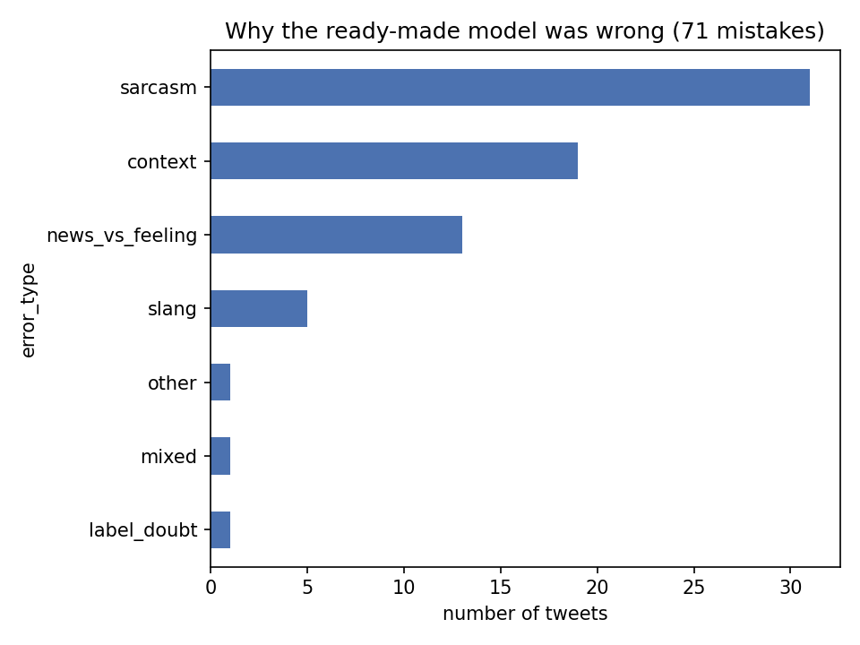

# Phase 4 findings: where sentiment models fail

## What I tested
I built a hard set of 150 tweets: 100 where the ready-made model disagreed
with the dataset label, and 50 irony tweets. I labeled them myself, starting
from an AI-assisted first draft that I then reviewed and corrected. I changed
about 50 to 60 rows, roughly a third, so even an AI labeler disagreed with a
careful human reader on many hard tweets. A normal test score is an average
over thousands of tweets and hides where a model fails, so a small set of
difficult tweets shows the failure types more clearly.

## How the models did
- Ready-made model agrees with my labels on 53% of tweets (fine-tuned: 46%).
- Sarcastic tweets: ready-made 40%, fine-tuned 26%.
  Non-sarcastic tweets: ready-made 60%, fine-tuned 57%.

Sarcasm is the biggest weakness for both models. The smaller fine-tuned model
is hit harder, especially on the 50 irony tweets (28% agreement against 46%
for the ready-made model).

## Why the models fail (71 mistakes)

- Sarcasm: 31 (44%)
- Needs outside context: 19 (27%)
- News read as feeling: 13 (18%)
- Slang: 5 (7%)
- Other, mixed feelings, doubtful label: 1 each

Sarcasm, context and news-versus-feeling cause 89% of the mistakes.
- **Sarcasm:** the model follows the literal words and misses the real meaning,
  often when a hashtag such as #not reverses the sentence.
- **Context:** some tweets can only be understood if you know the person or
  news event they refer to, and the model has no background knowledge.
- **News versus feeling:** the model confuses plain reporting with emotion.
  I expect this to matter for defence videos, where neutral news often
  describes attacks or weapons.

## Confidence does not help
The ready-made model's average confidence was about 0.70 on sarcastic tweets
and 0.68 on the others. It is just as sure when it is wrong, so a rule based
on low confidence would not catch sarcasm. A "needs review" list needs extra
rules.

## What I would do next
1. Send every comment containing #not, #sarcasm or #irony to human review,
   because these tags often reverse the meaning.
2. Before trusting the model on defence videos, hand-label about 50 factual
   comments (news, announcements, specifications) and check how often the
   model calls them negative.
3. Build the review list from: those hashtags, comments that need background
   knowledge, and comments where the model's top two scores are close. I will
   test whether that last signal works better than confidence.

## Limits
- Only 150 tweets, hard by design: this is a stress test, not an accuracy score.
- Only 20 tweets are positive, so I report totals and the sarcasm gap,
  not per-class scores.
- With 53 sarcastic tweets, the sarcasm gap is an estimate, but about
  20 points is large enough to take seriously.
- The first draft of labels was AI-assisted, so agreement with models may look
  slightly higher than it should.

Draft written with AI assistance and edited by me. All numbers come from my own
experiments.